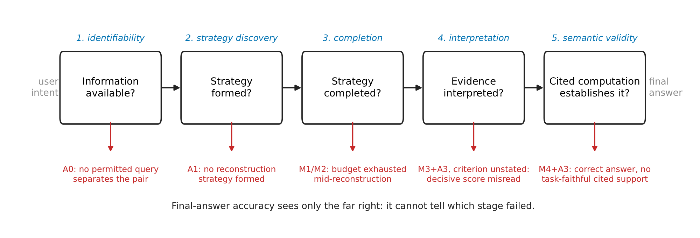
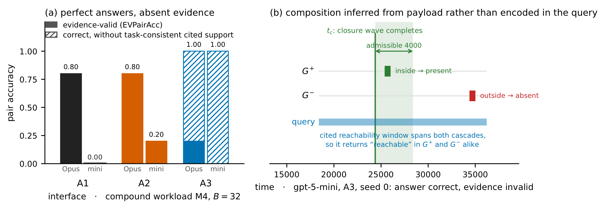

# Capability Is Not Validity: Evaluating Agentic Temporal Graph Analysis

Code, configurations, preregistration records and the complete run corpus for the WSDM 2027 paper
*Capability Is Not Validity: Evaluating Agentic Temporal Graph Analysis*
([doi:10.1145/3862322.3863709](https://doi.org/10.1145/3862322.3863709)). See [Citation](#citation).

## What this project is about

LLM agents increasingly analyze data by calling tools step by step and then reporting an answer.
Final-answer accuracy is the usual way to evaluate them, but it hides two different questions:

- **Capability.** Can this model, given this tool interface, reach the right conclusion at all?
  The answer depends on whether the interface exposes the needed information, whether the model
  finds a strategy, and whether it completes that strategy within its budget.
- **Evidence validity.** When the model is right, does the computation it *cites* as evidence
  actually establish the proposition it was asked about? Or did it reach the answer some other way?

This project measures the two separately and deterministically, with no LLM judge. Temporal graphs
are the testbed, because the answer to a temporal question can be flipped while everything
non-temporal stays the same.



*An analysis can fail at five stages. Final-answer accuracy observes only the far right, so it
cannot tell which stage failed. Each red label is a failure this project measures.*

### Matched temporal counterfactuals

Every task is asked on a pair of worlds, `G+` and `G-`.

- **What is held fixed.** The two worlds have the same node set, the same static edge multiset,
  the same number of events and the same global multiset of timestamps, **by construction**.
- **What differs.** Only which event carries which timestamp. That assignment is permuted so the
  target temporal proposition is true in `G+` and false in `G-`.

An agent that does not use the decisive temporal evidence cannot tell the two worlds apart.

The four mechanisms:

| | mechanism | question |
|---|---|---|
| M1 | bounded cascade | Is there a time-respecting path from s to t with every wait at most Δ? |
| M2 | closure wave | Does a large enough share of a focal node set's triangles close within δ of their second edge? |
| M3 | regime switch | Does a group's set of partners turn over abruptly at some point in time? |
| M4 | compound | Does a bounded cascade lie inside the interval that opens when a closure wave completes? |

M4 is built so that both worlds satisfy each component on its own; only their composition in time
differs.

### Interfaces and models

The same agent loop, task text and stopping rules are run with four tool interfaces:

| | interface | what the agent gets |
|---|---|---|
| A0 | aggregates | full-horizon aggregates only; an identifiability control |
| A1 | windowed primitives | aggregates over arbitrary time windows; temporal order must be reconstructed by interaction |
| A2 | raw events + code | the raw `(u, v, t)` events in a sandboxed Python interpreter |
| A3 | semantic operators | temporal operators such as Δ-bounded reachability and temporal closure |

The models are `gpt-5-mini` and Claude Opus 5, plus a Qwen2.5-Instruct ladder (7B, 14B and 32B,
AWQ) served locally through the same agent loop, and a deterministic reconstruction script as a
reference.

### Metrics

- **PairAcc.** A pair counts only when both worlds are answered correctly.
- **EVPairAcc.** Both answers must also be backed by evidence. A run is evidence-valid when its
  answer is correct and at least one computation it cites as support passes `SemValid`, a
  deterministic check that the call carries the task's constraints (the right bound, the right
  interval).
- **ExecEVPairAcc.** The same test applied to all executed steps, not only the cited ones. It
  separates "computed the right thing but did not cite it" from "never computed it".

### The headline result



On the compound workload M4 with semantic operators (A3), both models classify every pair
correctly (PairAcc 1.00). Opus is evidence-valid in one of five pairs (EVPairAcc 0.20);
`gpt-5-mini` in none (0.00). Its cited queries never instantiate the admissible interval; it infers
the composition from arrival times in the returned payload instead (panel b: a query window that
spans both cascades returns "reachable" in both worlds). **The final answer can be right while the cited analysis does not establish it.**

Capability behaves differently.

- A1 produces frontiers that depend on the model and the interaction budget.
- Raw events (A2) remove the M1 frontier in the tested settings.
- Nuisance activity and a four-fold larger graph push a configuration that succeeded on A1 back
  below its frontier.

## Layout

```
configs/           mechanisms.yaml (world generators), experiment_matrix.yaml (frozen sweeps),
                   models.yaml
worlds/            temporal-world construction, invariant checks, mechanisms/ (M1-M4), confounders/
tasks/             task schema, served task templates, deterministic pair compiler
tools/             the four interface surfaces exposed to agents (A0-A3)
agents/            model backends, agent loop, tool schemas
traces/            trace schema (every episode stores its full trajectory)
evaluation/        deterministic scoring: checker, SemValid / error taxonomy, EVPairAcc and
                   ExecEVPairAcc (exec_support.py; rule switch in ev_rule.py), metrics, shared
                   figure data (figdata.py)
scripts/           analysis, figures, tests, and run orchestration (see below)
runs/              the complete corpus: results.jsonl + stored traces per sweep
figures/           the paper's figures, regenerated from runs/ by scripts/figure*.py
docs/              images used in this README, rendered from the paper's figures
PREREGISTRATION*.md  cell/model/analysis declarations frozen before each experiment,
                   including all protocol amendments and one disclosed execution incident
```

The preregistration files are verbatim frozen records; they occasionally cite internal working
documents (e.g. `PAPER_CLAIMS.md`) that are not part of this artifact.

`data/` (compiled worlds and task records) is generated, not committed; it is regenerated
deterministically from `configs/mechanisms.yaml`, so a fresh clone reproduces byte-identical
worlds and world hashes. `runs/` holds the scored results and stored traces that every figure and
number in the paper is read from.

## Reproducing the paper

All analysis runs offline from the committed corpus; no model credentials are needed.

```
python scripts/paper_numbers.py        # every number quoted in the paper
python scripts/test_ev_rule.py         # the evidence-validity rule, on synthetic traces and the corpus
python scripts/figure1.py              # M4 accuracy vs evidence validity
python scripts/figure2.py              # M1 capability frontier + reconstruction
python scripts/figure_framework.py     # staged profile and the four mechanisms
python scripts/bootstrap_contrast.py   # the one reported confidence interval
python scripts/rescore.py --all        # rebuild scored rows from stored traces
python scripts/replay_backend.py --all # backend cost via replay, no LLM calls
python scripts/diag_m4_anchor.py       # per-run M4 stage-2 windows vs the oracle t_c
```

### Evidence-validity rule

`EVPairAcc` follows the rule the paper states (Eq. 3): a run is evidence-valid when its decision
is correct, its claim cites no nonexistent step, and **at least one** step it cites as support
satisfies the task-constraint test `SemValid` (`evaluation/exec_support.py`; for A1, whose
operations take no task-constraint argument, any successfully executed cited step satisfies it).
Exploratory calls cited beside the task-bound computation are not penalized, and an empty support
set is evidence-invalid. The rule is derived from the stored traces at analysis time, exactly as
`ExecEVPairAcc` is; `runs/` is not modified.

The reviewed submission computed `EVPairAcc` with a stricter rule on one branch: for A3 on M1-M3 a
run failed as soon as *any* semantic call cited as support carried a bound different from the
task's, even when the task-bound call was cited beside it. That rule is kept under a flag so the
submitted values remain reproducible:

```
python scripts/paper_numbers.py --ev-rule submitted    # or: ATGP_EV_RULE=submitted
python scripts/test_ev_rule.py                         # asserts both rules on the corpus
```

The two rules give different verdicts on 60 of the 1,402 corpus rows (58 on A3, all in M1-M3, and
2 on A1) and agree on every A0, A2 and M4 row. The affected values are the A3 `EVPairAcc` cells
of M1-M3: 1.00 / 1.00 (M1), 0.80 / 1.00 (M2), 1.00 / 1.00 (M3) for Opus 5 / gpt-5-mini under the
stated rule, against 0.67 / 0.53, 0.20 / 0.80, 0.60 / 1.00 under the submitted one. `PairAcc`,
`ExecEVPairAcc` and every M4 value are identical under both.

Requires Python 3.11 with `numpy`, `matplotlib`, and `pyyaml` (`pip install -r
requirements.txt`). Only `scripts/run_matrix.py` (running *new* episodes) needs model
credentials: `ANTHROPIC_API_KEY` / `OPENAI_API_KEY` via environment, or a local OpenAI-compatible
endpoint for the open-weight ladder (`scripts/ladder_job.sbatch` shows the vLLM serving job; set
your own SLURM account/partition).

## Corpus conventions

- The reported corpus is every scored run whose world recompiles to its recorded hash, minus
  superseded sweeps. Supersessions are explicit, never deletions: directories named
  `*_INVALID_*` / `*_PRE_AMENDMENT` and the `SKIP_DIRS` list in `evaluation/figdata.py` record
  exactly which sweeps were replaced and why; the preregistration documents record the
  corresponding protocol amendments.
- Run identifiers are content-derived (task, condition, model, prompt hash, world hash), so a
  configuration change that should change behavior must change run ids —
  `scripts/preflight_new_worlds.py` enforces this before any re-run.
- `scripts/test_*.py` and `scripts/selftest_schemas.py` are the invariant and schema test suite.

## Citation

If you use this code or corpus, please cite:

> Xiaofei Zhang. 2027. Capability Is Not Validity: Evaluating Agentic Temporal Graph Analysis. In
> *Proceedings of the Twentieth ACM International Conference on Web Search and Data Mining (WSDM
> '27), February 15–19, 2027, Hong Kong, Hong Kong.* ACM, New York, NY, USA, 10 pages.
> https://doi.org/10.1145/3862322.3863709

```bibtex
@inproceedings{zhang2027capability,
  author    = {Zhang, Xiaofei},
  title     = {Capability Is Not Validity: Evaluating Agentic Temporal Graph Analysis},
  booktitle = {Proceedings of the Twentieth ACM International Conference on Web Search and Data Mining},
  series    = {WSDM '27},
  year      = {2027},
  month     = feb,
  location  = {Hong Kong, Hong Kong},
  publisher = {Association for Computing Machinery},
  address   = {New York, NY, USA},
  isbn      = {979-8-4007-3117-4},
  doi       = {10.1145/3862322.3863709},
  url       = {https://doi.org/10.1145/3862322.3863709},
  numpages  = {10},
  keywords  = {agentic data analysis, temporal graphs, LLM agents, tool interfaces, evaluation}
}
```

## License

MIT (see `LICENSE`). The paper is published under a Creative Commons Attribution (CC BY) license.
